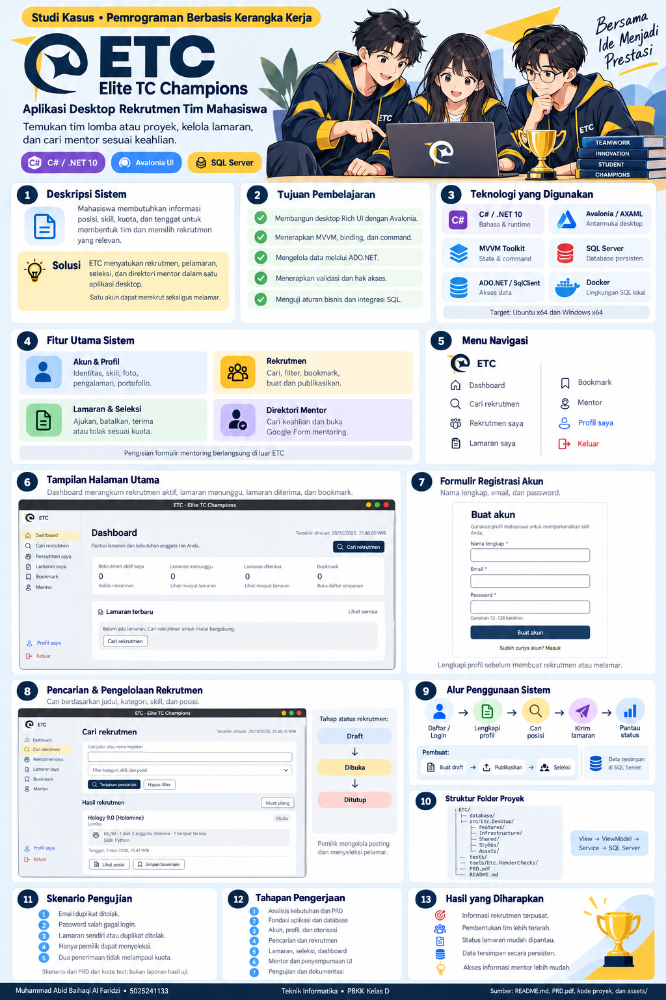

# Soal:
1. Jelaskan deskripsi dan ruang lingkup fitur aplikasi Desktop Rich UI yang dibuat.
2. Apa latar belakang dan Manfaat aplikasi tersebut di buat.
3. Buat Poster Infografis aplikasi yang telah dibuat dalam 1 halaman.

# Jawaban:
1. Deskripsi dan ruang lingkup fitur aplikasi Desktop Rich UI yang dibuat:

    ETC (*Elite TC Champions*) adalah aplikasi desktop untuk membantu mahasiswa
    menemukan anggota tim, mencari rekrutmen lomba atau proyek, serta menemukan
    mentor sesuai keahlian. Satu akun dapat membuat rekrutmen sekaligus melamar ke
    rekrutmen mahasiswa lain.

    Aplikasi dibangun menggunakan **C#**, **.NET 10**, dan **Avalonia UI** sehingga
    dapat dijalankan pada Ubuntu maupun Windows. Data disimpan secara persisten di
    **SQL Server** dan diakses menggunakan **ADO.NET** melalui package
    `Microsoft.Data.SqlClient`.

    **Fitur**:
    - Registrasi, login, logout, dan pengelolaan profil mahasiswa.
    - Pengelolaan skill, pengalaman, foto, bio, dan tautan portofolio.
    - Dashboard statistik pribadi.
    - Pembuatan, pengeditan, publikasi, dan penutupan rekrutmen.
    - Posisi, kuota, kategori lomba/proyek, jadwal, biaya, dan informasi kontak.
    - Pencarian, filter, pagination, serta bookmark rekrutmen.
    - Pengajuan, pembatalan, penerimaan, dan penolakan lamaran.
    - Daftar lamaran milik pengguna dan daftar pelamar pada rekrutmen sendiri.
    - Direktori mentor berdasarkan nama atau keahlian.
    - Tautan Google Form untuk kebutuhan mentoring.
    - Validasi input, pembatasan akses berdasarkan pemilik data, dan validasi kuota.
    - Penyimpanan data menggunakan SQL Server dengan schema dan data demo.
    - Tema antarmuka desktop menggunakan Avalonia dan Fluent theme.

2. Latar belakang dan manfaat aplikasi tersebut dibuat:

    Latar Belakang:
    Perkembangan pesat teknologi informasi di era digital menuntut mahasiswa Teknik Informatika Institut Teknologi Sepuluh Nopember (ITS) untuk tidak hanya menguasai akademik, tetapi juga aktif mengasah keterampilan praktis melalui perlombaan dan proyek kolaboratif. Namun, hasil survei internal menunjukkan bahwa mahasiswa masih menghadapi berbagai hambatan nyata dalam mengembangkan potensi tersebut di Departemen. Kendala utama yang ditemukan mencakup terbatasnya ketersediaan pembimbing atau mentor, sulitnya menemukan rekan tim yang memiliki minat dan komplementaritas keahlian, serta minimnya akses terpusat terhadap informasi tepercaya mengenai peluang kompetisi, riset, maupun proyek yang sedang berjalan.

    Kondisi tersebut menyebabkan banyak potensi ide dan bakat mahasiswa tidak tersalurkan secara optimal karena keterbatasan jejaring dan kurangnya sistem pendukung yang terintegrasi. Oleh karena itu, diperlukan sebuah platform berbasis web yang dirancang khusus sebagai solusi satu pintu untuk menjembatani kebutuhan kolaborasi tersebut. Web ini hadir untuk memfasilitasi pembentukan tim, membangun komunitas jejaring antar-mahasiswa, menghubungkan mahasiswa dengan mentor yang relevan, serta menyediakan pusat informasi terkini terkait lomba, proyek, dan riset secara efisien dan terstruktur.

    Manfaat:
    - Menyediakan informasi kegiatan dan rekrutmen lomba dan proyek.
    - Membantu mahasiswa mengelola rekrutmen dan menyeleksi lamaran sesuai kewenangannya.
    - Membantu mahasiswa menemukan informasi mentor untuk mentoring lomba atau proyek dan membuka formulir mentoring yang tersedia.

3. Poster Infografis aplikasi:

    
